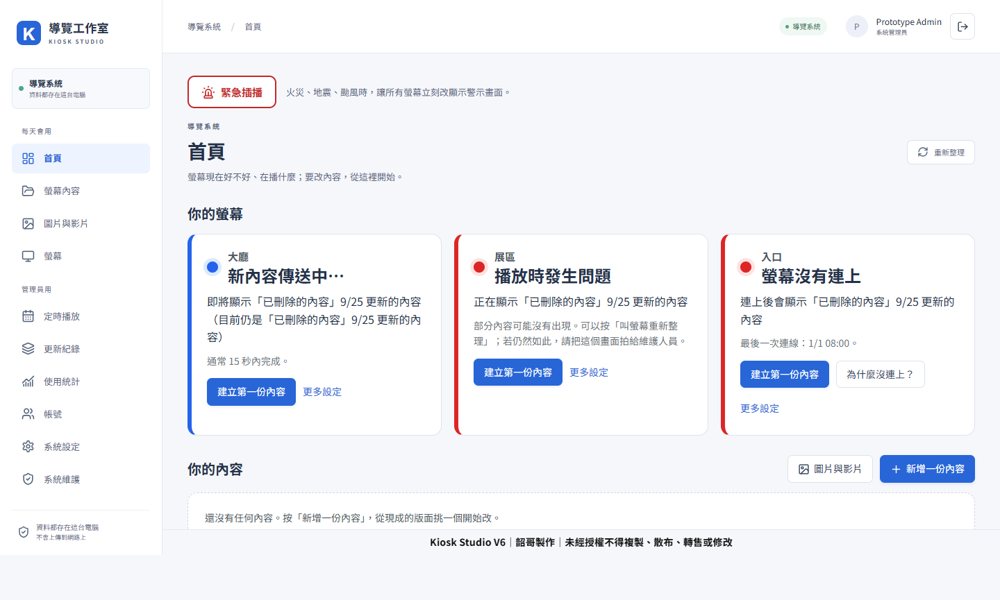
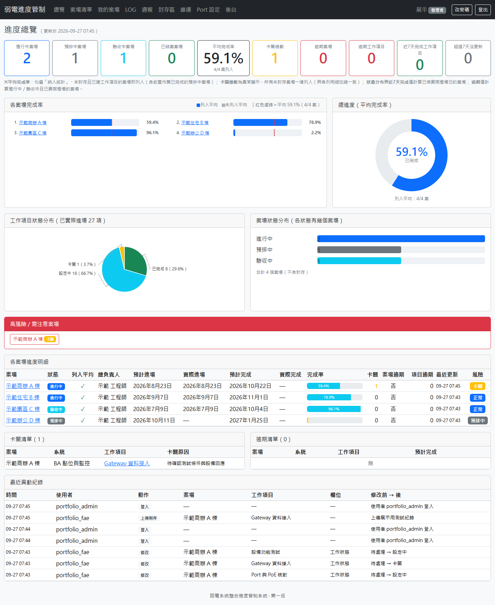
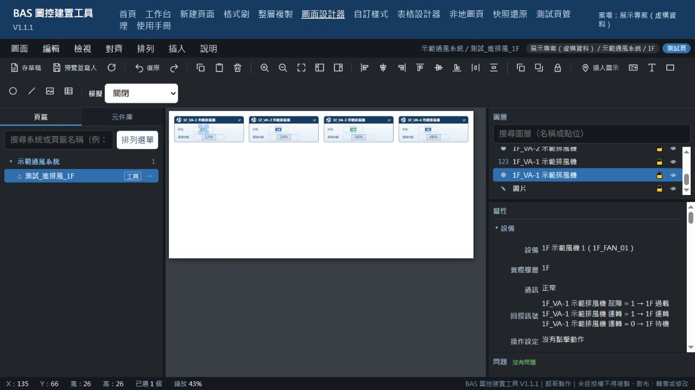
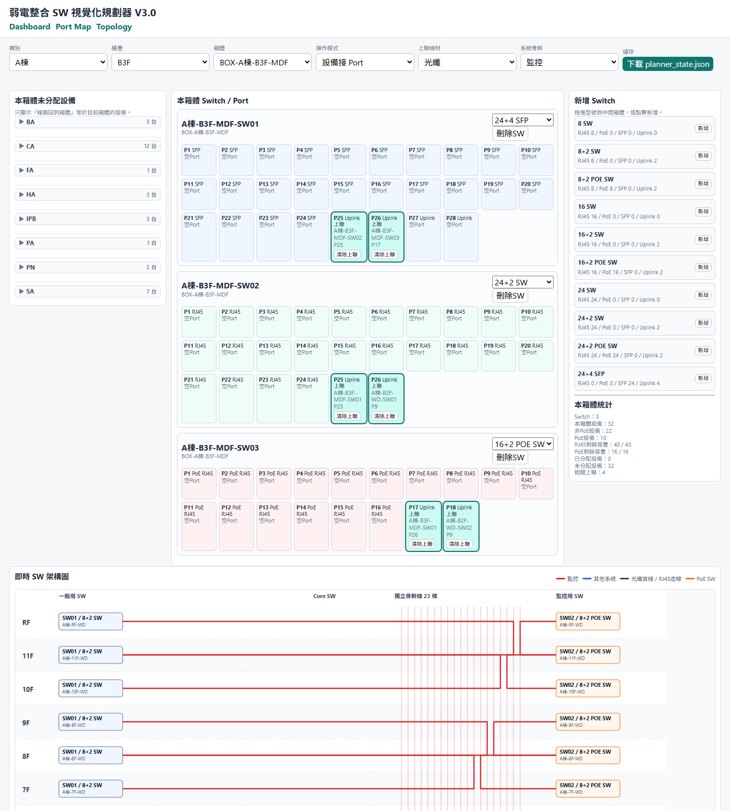

# 智慧建築系統整合｜BA／BMS 現場工具與 AI 協作開發

我是智慧建築系統整合工程師，也寫 BA。我的工作方式是從案場問題出發：釐清卡點與工程規則，再用 Python、Web 與生成式 AI 協作開發，把解法做成可操作、可測試、可持續調整的工具。

我運用 **Vibe Coding／AI 協作開發**進行需求拆解、原型建立、程式調整和除錯；工程判斷、功能檢查與結果驗證由我負責。把現場經驗轉成軟體方案，是我在系統整合工作上的另一項能力。

**求職方向：BMS 應用工程師（Application Engineer, BMS）／樓宇自動化系統整合工程師。** 結合 BA 圖控、點位與通訊整合、現場調試及驗收經驗，投入系統功能測試、監控介面建置、故障診斷、文件製作與交付，並以 Python 與 AI 協作開發改善工程流程。

對應 BMS 應用工程工作，可先閱讀 **[BA Gateway](case-studies/ba-gateway.md)** 的點位與監測流程、**[BAS 圖控建置工具](case-studies/bas-graphic-builder.md)** 的配對／建置／健檢與驗收流程，以及 **[案場進度管理](case-studies/project-tracker.md)** 的卡關追蹤與交付管理。導覽機保留為展示完整開發流程的代表作品。

## 四個主要專案

| 專案 | 案場痛點 | 我做出的解法 |
|---|---|---|
| [導覽機內容管理與播放器（代表作品）](case-studies/kiosk-studio.md) | 版型、素材、發布版本和播放設備分開管理，更新後不易確認播放內容 | 頁面與模板編輯、素材管理、發布與螢幕指派；表格／即時資訊元件、草稿復原及播放器更新 |
| [BA Gateway 與戰情看板](case-studies/ba-gateway.md) | 點位、監測狀態與看板分散，異常時不易順著資料流程檢查 | 點位資料管理、即時與歷史檢視、看板編輯；持續擴充能源、需量管理與情境流程 |
| [弱電案場進度管制系統](case-studies/project-tracker.md) | 進度、卡關原因、附件和週報分散，管理資訊需重新彙整 | 集中案場、工作項目、異動紀錄、週報與管理總覽 |
| [BAS 圖控建置工具](case-studies/bas-graphic-builder.md) | 逐顆設圖、綁點位與跨樓層建置重複，版型不一致，驗收容易遺漏 | 建置精靈、圖面設計器、點位配對、格式刷／樓層複製、健檢、快照與交付工作台 |

### 導覽機：從內容編排到播放器

整合頁面範本、表格與即時資訊元件、素材、發布管理及網頁播放器。[查看系統流程與更多畫面](case-studies/kiosk-studio.md)

### BA Gateway：點位、監測與看板

從資料接入與點位檢視，延伸到看板編輯、歷史與狀態呈現。[查看點位清單、看板管理與編輯器](case-studies/ba-gateway.md)

### 案場進度管理：進度、卡關與週報

讓工作進度、卡關原因與週報沿用同一份資料。[查看案場清單、工作詳情、週報與異動紀錄](case-studies/project-tracker.md)

### BAS 圖控建置：把 BA 工程流程做成工作工具

以建置精靈、模板、點位配對與圖面設計器處理大量重複建置，再接續健檢、快照與驗收工作台。[查看 V1.1.1 功能及四張操作畫面](case-studies/bas-graphic-builder.md)

以上畫面使用展示資料；BAS 圖控建置畫面在隔離模擬器操作，未連接案場設備。

## 延伸作品與工程小工具

### 弱電與 BA 視覺化規劃器

互動配置設備與 Port，檢查 PoE、SFP 和上聯規則，整合 BA 規劃並輸出工作表。[查看規劃流程與拓樸畫面](case-studies/low-voltage-planner.md)

[全部工具索引](TOOLS_CATALOG.md)收錄資料採集、能源用水分析、通訊測試、工程表格與文件整理、展示內容、GIF 與圖片處理等工具。

可公開試用的示範程式：

- [BA 底圖批次最佳化工具](public-code/ba-image-optimizer/README.md)
- [Modbus 暫存器解碼示範](public-code/modbus-register-decoder/README.md)

## AI 協作開發如何用在工作上

由我定義案場問題、操作流程與工程規則，運用 AI 協助拆解需求、程式初稿、錯誤分析及介面迭代，再自行操作、測試及核對結果。四個主要專案與工程小工具，都是這套方式的應用成果。

[查看 AI 協作開發流程](case-studies/ai-assisted-development.md)

完整系統與現場連線設定保留私有；公開作品集提供去識別化案例、操作畫面和精選示範程式。
