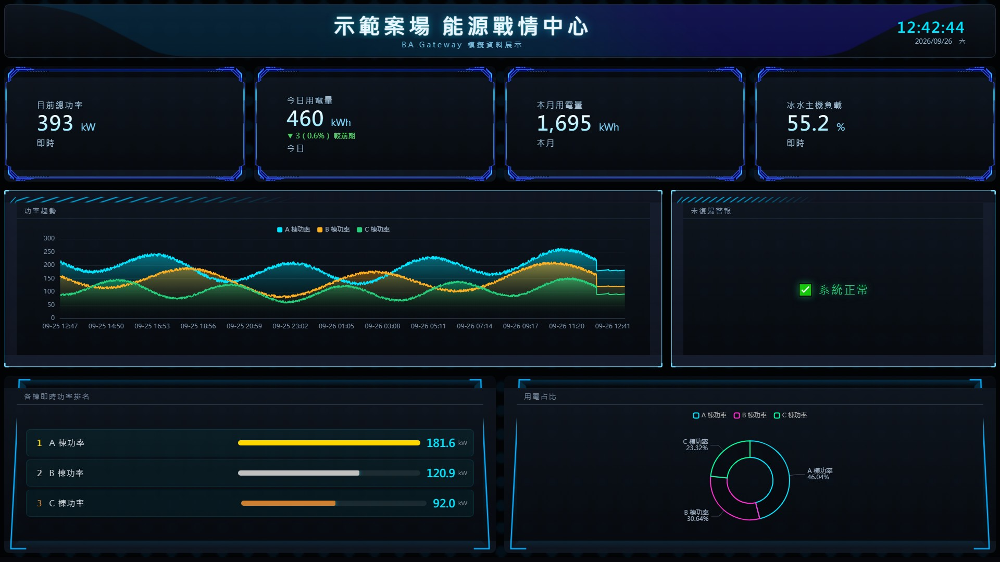
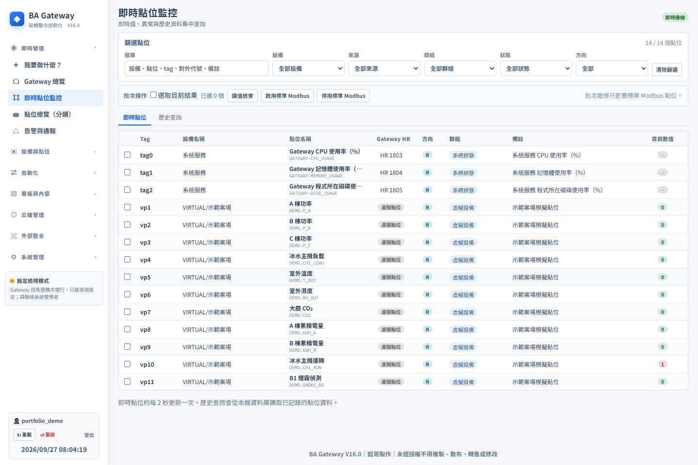
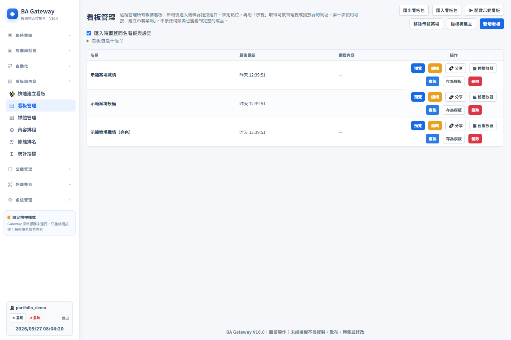
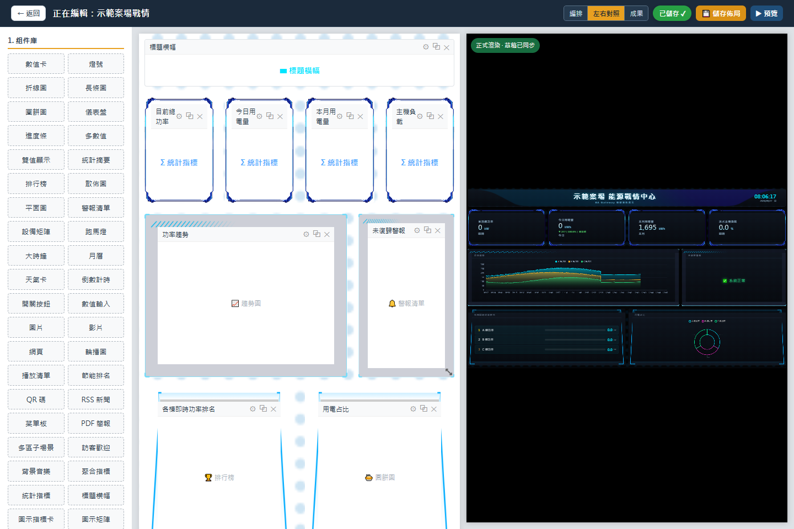
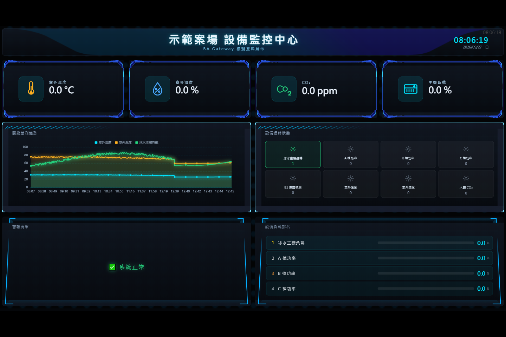

# BA Gateway 與 BAS 戰情看板

*畫面由 BA Gateway 內建「示範案場」功能實際輸出；功率、用電與趨勢數值均為模擬資料。*

## 從點位到看板：實際系統畫面

以下畫面由 BA Gateway 原系統搭配內建示範案場資料拍攝，依照工程師使用順序排列。

### 1. 核對點位

點位頁把名稱、來源、讀值與更新狀態放在同一處。示範資料包含電力、冰水主機、溫濕度與 CO₂ 等類型，可用來檢查後續看板所引用的點位。

### 2. 選擇與管理看板

看板列表可進入檢視、編輯與分享流程；同一批點位可依能源、設備或不同顯示風格編排。

### 3. 在編輯器排版並對照正式畫面

編輯器左側是元件庫與可調整版面，右側同步顯示正式播放效果。工程師修改數值卡、趨勢圖、警報清單或設備矩陣時，可以直接核對畫面呈現。

### 4. 查看不同用途的播放畫面

設備監控版面把環境數值、關鍵量趨勢、設備狀態與警報放在同一屏。這些讀值和名稱皆屬示範資料。

## 問題與目標

建築現場設備資料分散在不同通訊協定和品牌系統中。此專案將點位讀取、資料保存、警報和畫面展示整合在同一套 Gateway 中，讓現場人員能設定設備、檢視狀態並向其他系統提供資料。

現場常見的工作是把設備點位逐一整理、確認資料品質，再交付給看板與其他系統使用。當點位、規則和畫面分散管理，後續查找異常與改版會反覆對照設定。Gateway 將這些步驟串成同一個流程。

## 我做的工作

從 BA 點位與現場使用情境出發，規劃 Gateway 的資料流程，並實作點位接入、狀態呈現、警報規則與可編輯看板。這份作品展示的是「系統整合工程師把現場需求做成軟體平台」的能力。

## 一個可以說清楚的現場情境

假設現場新增一台標準 Modbus 設備，工程師知道 IP、Port 和 Unit ID，但畫面一直沒有值。單一「離線」標籤無法指出原因：可能是網路不通、協定沒有回應、暫存器位址選錯，也可能是讀到了資料卻用錯字組順序。這個專案把排查順序做進操作流程：

| 排查層次 | 工程師要回答的問題 | 專案中的處理 |
|---|---|---|
| 連線 | 主機與通訊埠能否連上？ | 儲存設定前可先測試連線；並顯示該連線被哪些設備使用。 |
| 協定 | Unit ID 與 Modbus 回應是否正確？ | 設備設定與診斷分開顯示協定結果及錯誤階段。 |
| 點位 | 功能碼、位址、型態、Endian、比例是否正確？ | 逐點讀取與解析，讓工程師核對原始值和工程值。 |
| 執行 | 上線後是否持續採集？ | 保存最後成功、錯誤原因、連續失敗與重試狀態。 |

這個情境呈現工程師如何使用系統排查；畫面使用示範資料。

## 關鍵設計決策

1. **先測再存。**連線測試與設定驗證放在寫入前，避免錯誤 IP、Port 或通訊參數到了執行期才暴露。
2. **設備與點位一起套用。**原本分兩步保存時，第二步失敗可能留下「有設備、沒有點位」的半套設定；程式改以同一請求驗證並以原子置換保存。
3. **把「網路可達」與「資料讀取成功」分開。**TCP 連上不等於 Modbus 點位可讀，狀態頁保留不同層次的診斷資訊。
4. **讓設定和畫面可維護。**點位、歷史、警報、平面圖和看板都沿同一資料流，避免畫面顯示的名稱與 Gateway 設定脫節。

介面因此把建立連線、加入設備、核對點位與查看採集狀態串在一起，讓下一個要檢查的環節更清楚。

## 主要功能

- Python Gateway 包含 Modbus、BAS API、點位、歷史、監測群組、平面圖、規則及模擬器能力。
- 原生 Web 看板支援即時點位、歷史資料、圖表、品質與離線狀態處理。
- V16 編輯器支援編排與正式播放器左右對照、草稿即時預覽，以及與舊版看板版面格式相容。
- TAG API／Webhook 文件描述點位讀寫、批次寫入、健康檢查、速率限制及第三方資料推送流程。
- 另有安裝、升級與操作說明，方便在內網環境維護。

## 技術重點

Python、Web UI、Modbus、REST API、Webhook、JSON、Excel 設定、即時與歷史資料視覺化。
