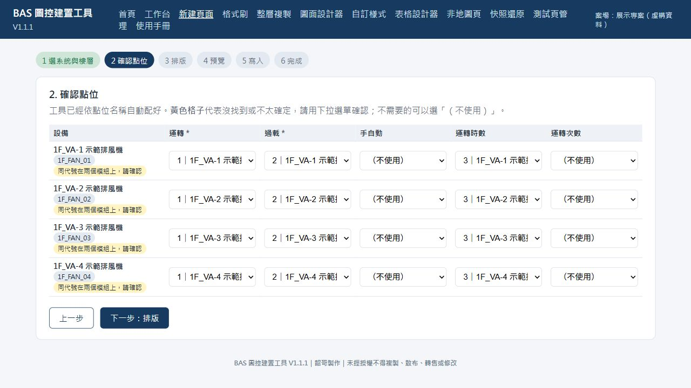
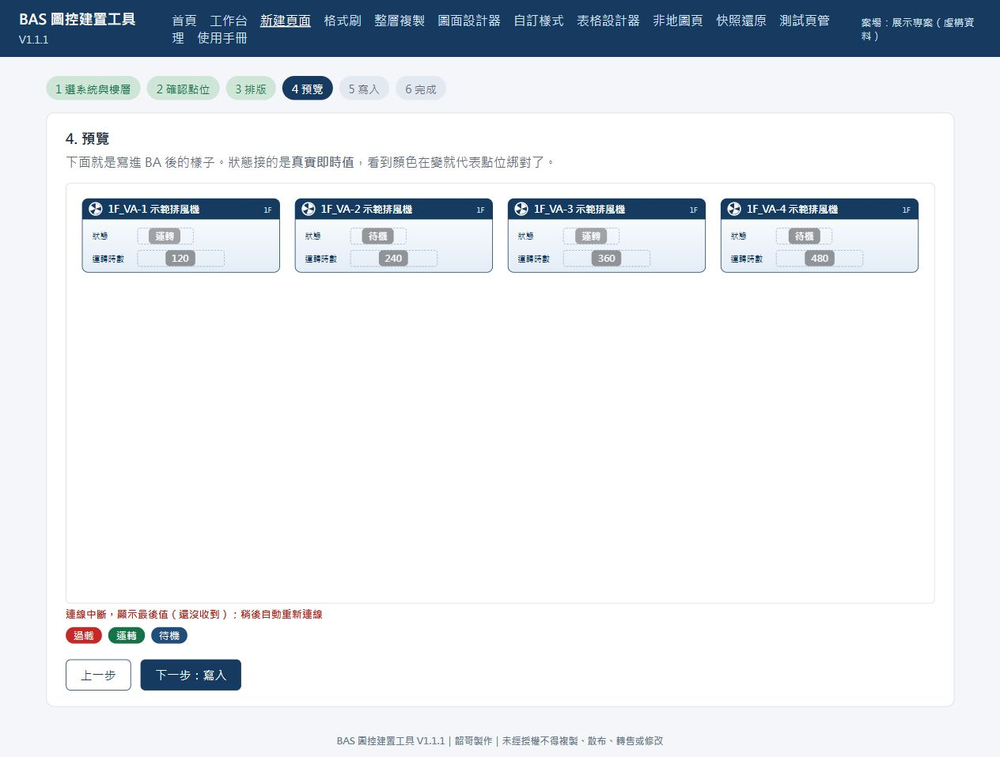
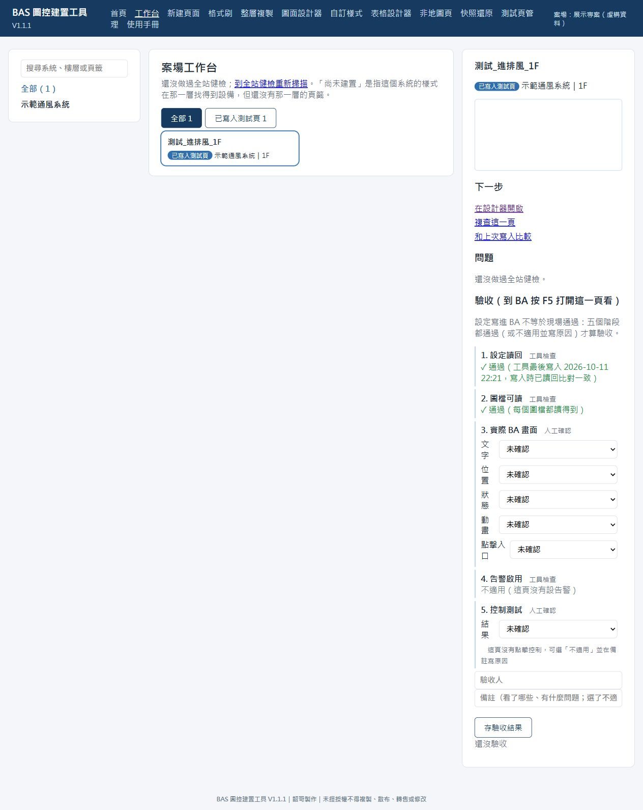

# BAS 圖控建置工具

把工程師逐頁、逐顆設定圖控的工作，整理成「建置、編輯、檢查、交付」流程。以 Python／FastAPI 與 Web 介面開發，目前持續迭代至 V1.1.1。

## 我想解決的案場問題

同一棟建築的樓層、設備與點位很多。工程師需要反覆建立頁面、擺放圖示、設定狀態與綁定點位；複製到其他樓層後又要重新核對。不同人建置的版型和告警呈現容易不一致，驗收時還要逐頁找漏圖、錯點位及未生效設定。

我把這些工程規則做成建置工具：先選系統、樓層與樣式，由程式配對設備及點位，再讓工程師確認、預覽和修改。日後調整時可以沿用原頁面、重用樣式、檢查差異，保留修改前的快照。

## 核心功能

| 工作 | 工具如何處理 |
|---|---|
| 建立圖控 | 建置精靈依系統、樓層及模板產生卡片牆、平面圖或總表；自動配對點位，未確定的項目交由工程師確認。 |
| 修改圖面 | 中文圖面設計器支援拖曳、對齊、圖層、點位選擇、狀態規則、離線顯示、文字與圖片元件；可存草稿並模擬狀態。 |
| 重複建置 | 格式刷、跨樓層複製、同類點位批次調整、樣式版本與批次換外觀，讓同類設備沿用一致設定。 |
| 表格與資料 | 表格設計器，以及 Excel 匯出／匯入，方便大量核對位置、單位與狀態設定。 |
| 檢查品質 | 全站健檢找出遺失圖檔、無效點位、重疊元件、離線顯示與告警設定問題，並可直接開啟對應頁面。 |
| 變更與交付 | 寫入前預覽差異與建立快照，寫入後讀回核對；工作台追蹤測試頁、草稿、問題與分階段驗收。 |

另持續擴充即時圖表、告警輔助呈現、文件入口、情境與排程管理等功能，讓工程師能從同一個工作介面處理圖控建置與維護。

## 操作畫面

以下為原工具 V1.1.1 在本機隔離模擬器的實際操作畫面。設備、點位、專案名稱與數值均為虛構示範資料。

### 1. 點位配對：工程規則先處理，工程師再核對

以運轉、故障、時數等角色呈現綁定，讓工程師檢查設備與欄位的對應。

### 2. 圖控預覽：確認排列、名稱與狀態

示範使用虛構讀值，展示頁面排版與狀態呈現；模擬器未提供現場即時串流。

### 3. 圖面設計器：從設備與點位檢查設定

選取圖控後，可看到設備、回授訊號、綁定點位與畫面設定；將現場判斷需要的資訊放在同一個介面。

### 4. 工作台：建置完成後接續檢查與驗收

區分設定讀回、圖檔可讀、實際畫面、告警啟用與控制測試，讓交付記錄有一致流程。

## 我的開發角色

由我定義 BA 建置情境、點位配對規則、使用流程與檢查方式，運用 AI 協作開發（Vibe Coding）完成程式初稿、除錯與介面迭代，再依工程規則操作測試及核對結果。

這個專案呈現我的能力：把 BA 現場知識轉成工具功能，兼顧操作效率、版型一致性、變更追蹤與交付品質。完整系統及案場設定保留私有，公開頁面提供去識別化介紹和示範畫面。

[回到四個主要專案](../README.md)
