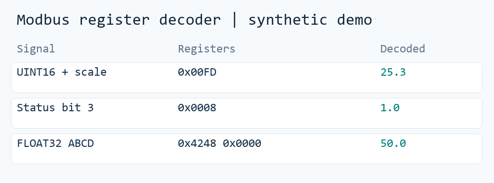

# 通用 Modbus 資料解析與模擬

*以本作品集公開的解碼程式實際執行三種示範資料：比例換算、位元狀態與浮點數。數值為虛構測試資料。*

## 問題與目標

工程現場的資料可能分布於不同的暫存器位址、資料型別與字組順序。此類工具將原始數值解析成標準點位，並以模擬器協助在沒有實體設備時驗證通訊流程。

例如同一段暫存器資料，若比例、位元位置或字組順序設定錯誤，看板就可能顯示看似合理卻不正確的值。我將讀取設定與解析規則拆開，方便工程師先用測試資料確認每個訊號的轉換結果。

## 主要功能

- BA 解析工具以 Profile 描述讀取區段、資料型別、位元欄位、字組順序、比例與衍生訊號。
- 可將解析後的點位映射到 Modbus TCP Server。
- 另有 Modbus 訊號模擬、橋接器和數值處理程式與技術文件。
- [Modbus 解碼示範](../public-code/modbus-register-decoder/README.md)可直接用虛構暫存器資料重現上方三筆結果。

## 技術重點

Python、RS-485、Modbus RTU／TCP、pymodbus、Excel／JSON Profile、暫存器解析、資料映射、日誌。
