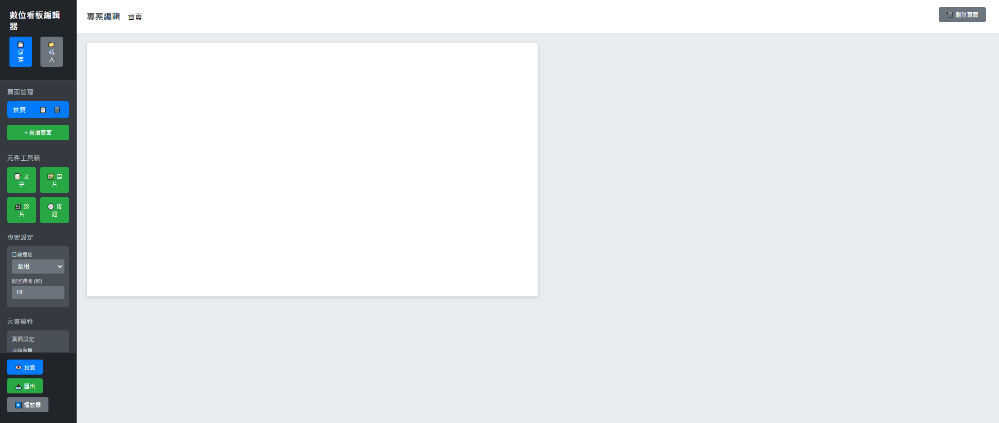

# 數位看板編輯與播放

## 編輯器畫面

這是我製作的瀏覽器版數位看板編輯器。左側可新增頁面與元件，並設定自動播放和輪播間隔；中間是可拖拉編排的畫布，完成後可預覽並交給播放器顯示。截圖是空白專案的編輯狀態。

## 想解決的現場問題

大廳或展示空間的螢幕內容會隨活動和使用需求調整。若每次變更文字、圖片或導覽按鈕都要直接改程式，維護成本高，也不方便非程式人員檢查版面。

## 我做的處理

- 將內容拆成頁面與元件，提供文字、圖片、影片和按鈕工具。
- 讓使用者在畫布上調整位置與大小，並於屬性區修改內容。
- 保存專案設定，再由播放器載入；支援頁面導覽及閒置後輪播。

這個版本展示的是前端編排與播放流程；較完整的後續系統請見[導覽機內容管理與網頁播放器](kiosk-studio.md)。
