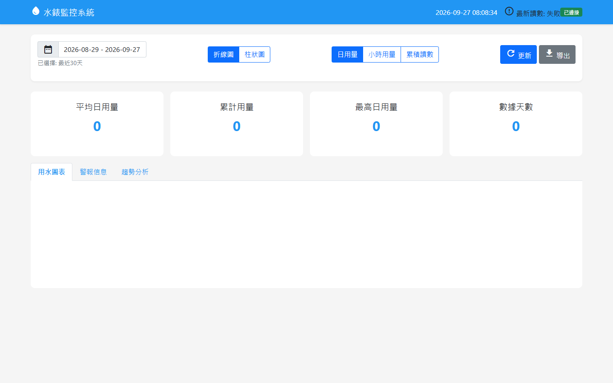

# 電錶與水錶用量分析

## 用水監測畫面

這是原用水監測程式的介面畫面。上方可切換折線／柱狀圖、日用量／小時用量／累積讀數，下方提供用水圖表、警報資訊和趨勢分析頁籤；畫面未連接案場資料，因此數值與圖表為空白狀態。

## 現場痛點

累積型電錶和水錶的讀值不能直接當成單期用量。讀值歸零、回捲或突然暴增時，直接相減會造成負數或不合理報表；用水資料也需要按日與月份整理，才看得出變化。

## 我做的處理

- 電價程式驗證新舊讀值，判斷可能的重置或回捲，並用歷史用量檢查結果是否合理。
- 對異常增量設門檻；在讀值不足以估算時回傳待確認狀態，而非硬算出用量。
- 電費依介面設定的夏月／非夏月參數與級距計算；調整費率時不必改動用量判斷流程。
- 用水程式包含 Modbus 讀取、數值驗證、累積量差分、日統計、趨勢查詢及 CSV 匯出。

## 為什麼不能直接用「本期－上期」

假設前次累積讀值為 9,990，本次變成 10。這可能是電錶回捲或重置，也可能是設備或資料品質問題。若直接相減，會得到負用量；若一律當成回捲，也可能把錯誤資料變成看似正常的報表。程式先辨識讀值變化類型，再結合歷史用量與合理上限決定是否估算或標示待確認。這個數字只是說明判斷順序的虛構例子。

處理鏈可拆為「原始讀值 → 數值驗證 → 差分與重置判斷 → 異常門檻 → 日／月彙總 → 電費或用水趨勢」。重點是先處理讀值品質，再讓報表呈現用量。
