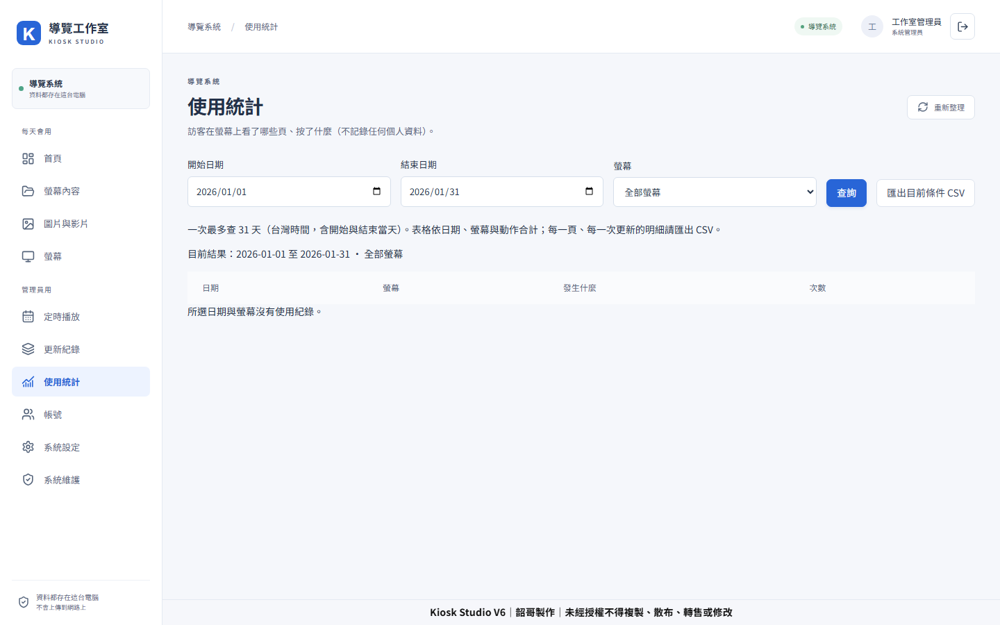
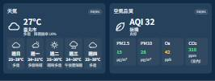

# 導覽機內容管理與網頁播放器

*管理首頁的開發畫面，使用展示資料。*

## 現場要解決的事

導覽螢幕的內容會依活動、時段與擺放位置更換。若版面、素材與播放設備各自管理，每次更新都要重新確認哪台螢幕正在播哪個版本，工程人員也容易成為內容修改的瓶頸。

我把內容製作與螢幕播放串成一個流程：先在管理端編輯頁面、組合元件與素材，再建立發布版本，最後指派給播放器。讓現場人員能從管理介面追查內容與播放狀態。

## 我做的系統流程

| 階段 | 管理者要做的事 | 系統中的設計 |
|---|---|---|
| 製作 | 建立頁面、選版型與素材 | 將頁面、元件與媒體資料分開管理 |
| 檢查 | 看畫面與播放效果 | 編輯器與網頁播放器分工，方便預覽與檢查 |
| 發布 | 決定螢幕要播哪份內容 | 以發布版本與設備指派管理播放內容 |
| 維護 | 查詢使用情況與後續調整 | 管理介面提供統計、篩選及資料匯出入口 |

## 系統畫面

*開發測試畫面，顯示日期篩選與 CSV 匯出入口。*

*以上畫面展示可組合的資訊元件。*

## 近期功能

近期版本新增頁面範本和整套版面範本、表格與天氣／空氣品質／交通等即時資訊元件，並調整素材上傳、草稿衝突救援和播放器更新處理。內容編輯、範本、媒體管理、發布版本與播放器形成連續流程，方便依活動更新畫面並確認播放版本。

作品持續開發驗證中，畫面使用展示資料。

## 技術重點

TypeScript、Web 前後端、PostgreSQL、媒體處理、Playwright、自動化驗證。
