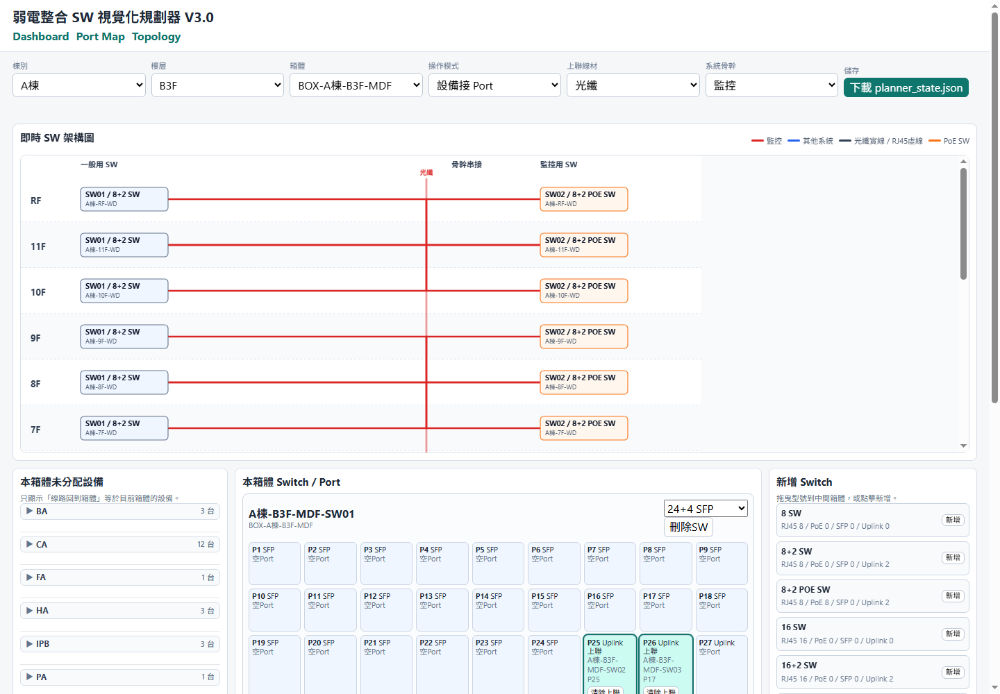

# 弱電視覺化規劃器

*原程式開發過程留下的測試畫面；顯示箱體內未分配設備、各台 SW 的 Port 與容量統計。畫面中的棟別和設備配置只用於呈現規劃流程，不作案場成果數字。*

## 問題與目標

弱電設計需要反覆核對設備、交換器 Port、PoE 容量、上聯線材與 BA 點位。此工具把 Excel 資料母版轉成可視化規劃畫面，並將結果寫回規劃表。

人工在多張表格之間修改時，同一台設備可能在清單、Port 表與骨幹圖中對不上；變更箱體或交換器型號後，原先的配置也得重新核對。程式把「設備屬於哪個箱體、接哪個 Port、需要哪種上聯」放在同一個操作流程中。

## 我做的工作

把現場工程規則轉成互動式檢查與配置流程，讓規劃人員能直接看出設備、Port 與上聯關係。這份作品呈現我同時理解弱電設計內容與軟體使用流程。

## 從一張設備表到可交付的規劃結果

| 步驟 | 原本容易出錯的地方 | 程式如何協助 |
|---|---|---|
| 匯入母版 | 棟別、樓層、箱體及設備欄位散在工作表 | 讀取 Excel，轉成按箱體檢視的設備與交換器資料。 |
| 分配設備 | 設備清單和 Port 表分開修改，容易漏接或重複分配 | 在同一畫面選設備、交換器與 Port；未分配設備持續可見。 |
| 規劃供電及上聯 | PoE、SFP、RJ45 和跨樓層連線靠人工記憶規則 | 接錯類型時檢查或提示；PoE 設備接一般 RJ45 時提示外部供電。 |
| 修改母版 | 設備或交換器變更後，既有規劃容易整份重做 | 以穩定識別與相容規則合併狀態，保留能沿用的配置。 |
| 交付 | 清單、Port 表和骨幹圖可能各有不同版本 | 由同一規劃狀態重建 Excel 表、未分配與異常清單。 |

例如一台需要 PoE 的設備被放到一般 RJ45 Port，程式會提示另行供電；若把設備拖到 SFP／Uplink Port，則不接受該分配。上聯線材選光纖或網路線時，允許的 Port 類型也不同。

**最重要的取捨：**規劃結果另外輸出，原始 Excel 母版保留；下載的 JSON 是可回復的規劃狀態。這讓現場人員可以檢查、調整再產生交付表，而不必把畫面當成唯一資料來源。

## 主要功能

- 依棟別、樓層與箱體檢視設備與交換器，透過拖拉或點選分配設備到 Port。
- 檢查 RJ45、PoE RJ45、SFP 與 Uplink 的分配規則，提示 PoE 設備接一般 RJ45 時的供電需求。
- 支援同箱體及跨樓層上聯規劃，並輸出交換器清單、Port 配置、光纖骨幹統計與異常檢查資料。
- BA 模組另處理設備模組、點位與 Modbus 接線規劃；新版母版載入時嘗試保留相容配置。
- 規劃狀態可下載為 JSON；依狀態重建交換器清單、Port 規劃、上聯骨幹、異常與未分配清單，原始母版不直接覆寫。

## 另一個操作視角

*展示資料呈現樓層之間的上聯路徑與交換器配置。*

## 技術重點

Python、Web UI、Excel 資料處理、工程規則檢查、JSON 規劃狀態。
