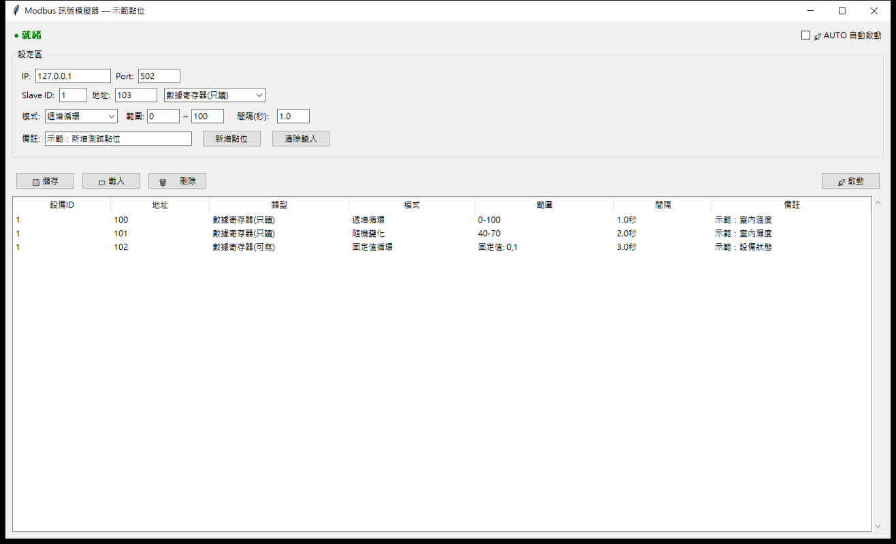

# Modbus 訊號模擬器

## 桌面程式畫面

這是原桌面程式以三個虛構點位拍攝的畫面。設定區指定本機 IP、Port、Slave ID、暫存器位址和變化模式；下方表格列出可保存、載入與重複使用的測試點位。截圖時沒有連接現場設備。

## 現場痛點

BA 畫面、點位解析與警報規則常需在設備尚未到場或無法佔用現場設備時先測試。沒有可控的訊號來源，就難以重現固定值、緩慢變化及邊界情況。

## 我做的處理

桌面介面可設定測試點位、Slave ID、位址、資料模式和更新間隔，再啟動本機 Modbus TCP 模擬服務。程式支援固定值、隨機值與遞增值模式，能保存／載入配置，也能在表格中編輯和複製點位。

## 工程師怎麼使用

1. 先建一組虛構測試點位，指定 Slave ID、位址和更新間隔。
2. 用固定值確認 BA 畫面的位址與比例；用遞增值確認趨勢更新；用隨機值觀察數值範圍與警報條件。
3. 讓 Gateway 或解析程式連到本機模擬服務，比對暫存器原值與畫面工程值。
4. 保存配置，之後重現同一組條件，方便回歸測試。

這讓「設備尚未到場」時仍能先準備和重現測試條件。
