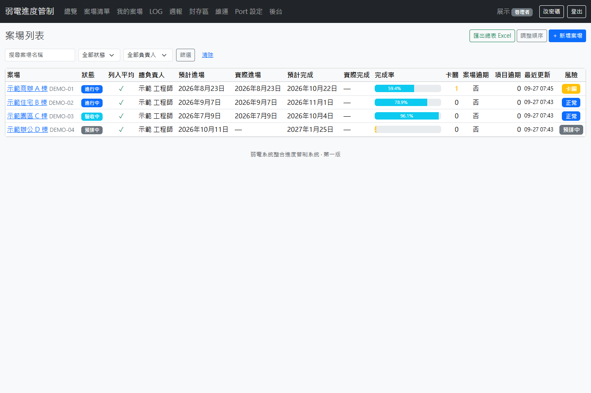
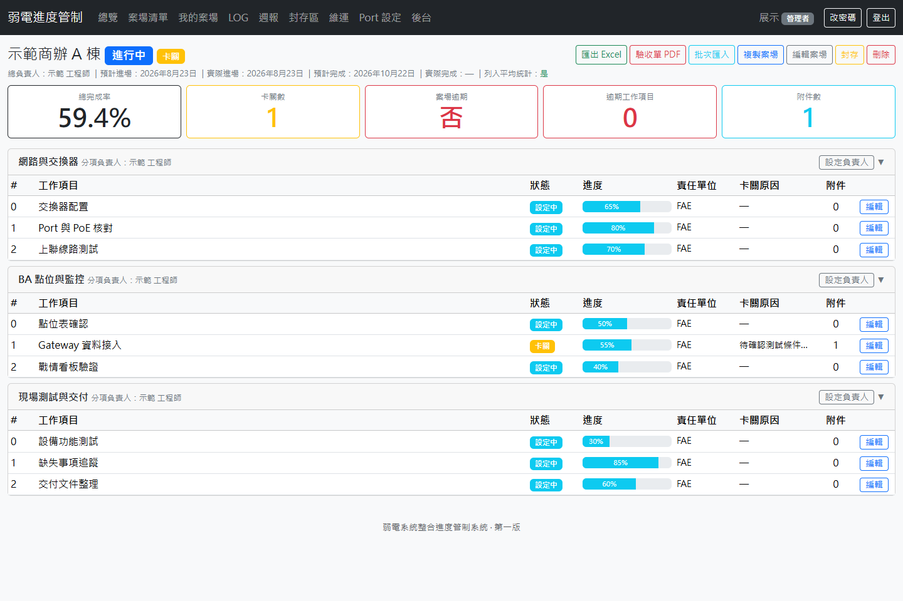
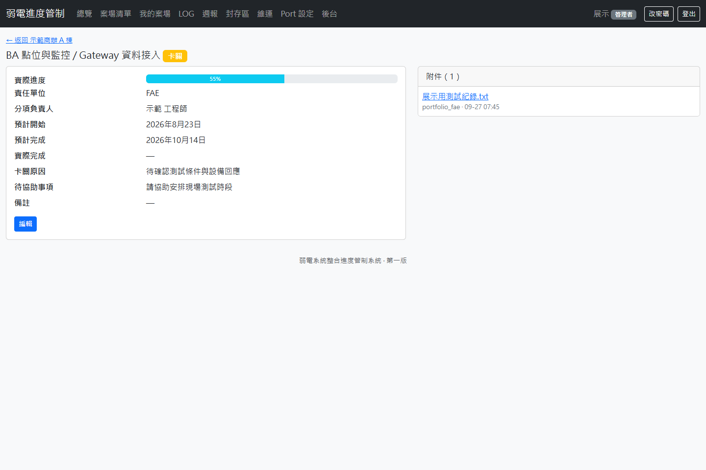
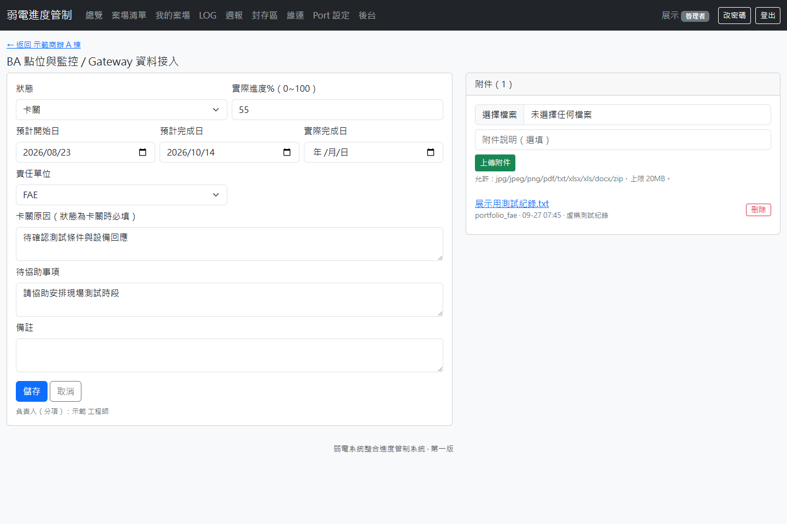
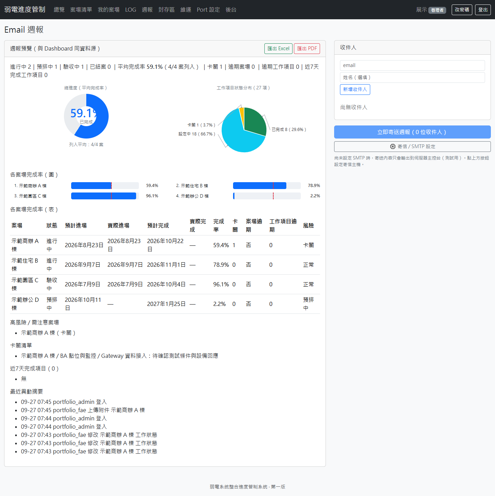
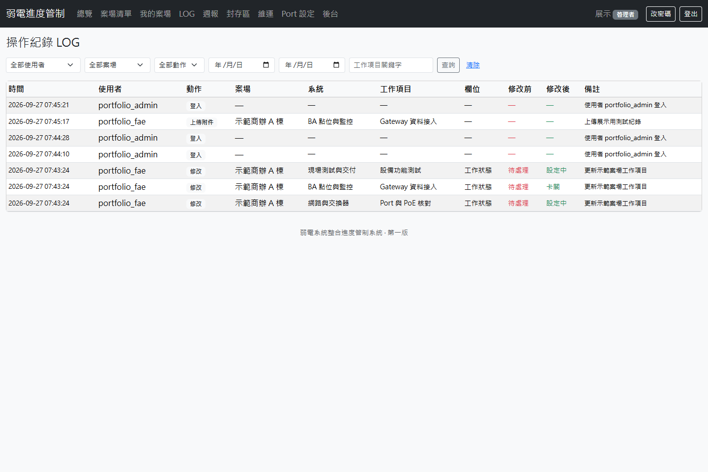

# 弱電案場進度管制系統

把分散在 Excel、通訊軟體與個人筆記裡的進度，整理成工程師和管理者都能使用的內網系統。每個案場依系統拆成工作項目，從更新進度、記錄卡關、附上文件，到產出週報都沿用同一份資料。

**畫面說明：**以下由原 Django 系統在隔離環境執行拍攝，所有案場、人名、任務與數值均為虛構展示資料。介面與操作流程來自原程式。

## 為什麼做這套系統

現場的進度表常由多人輪流修改。工作項目卡住時，表格可能只有一個百分比，找不到原因、待協助事項或相關附件；管理者要做週報，又得重新彙整每個案場。我把這些工作改成一條流程：**工程師更新工作 → 系統保留責任與異動 → 總覽呈現風險 → 週報使用同一批資料**。

## 從案場到週報的操作畫面

### 1. 找到要處理的案場

案場清單可搜尋、依狀態及負責人篩選，並直接看到完成率、卡關數、逾期項目和最近更新時間。工程師可用「我的案場」縮小工作範圍。

### 2. 進入案場，按系統追蹤工作

案場詳情把網路與交換器、BA 點位、現場測試等系統分開列出。每個工作項目都有狀態、進度、責任單位、卡關原因和附件數；上方可快速看到案場整體情況。

### 3. 記錄一件卡關工作

工作項目可同時保留已完成的進度和「卡關」狀態。工程師填寫原因、待協助事項及預計日期，也可附上測試紀錄。這樣主管看到卡關時，能直接理解下一步需要誰協助。

### 4. 用同一份資料看總覽與週報

總覽集中顯示案場完成率、工作狀態、高風險與卡關清單。週報頁沿用相同摘要，並提供 Excel、PDF 和 Email 流程，減少不同報表各自計算後口徑不一致的問題。

### 5. 回查誰在何時修改

操作紀錄可依使用者、案場、動作與日期查詢，顯示工作項目修改前後的值。進度有爭議時，不必再從多份 Excel 猜是哪一版。

## 我在實作時處理的幾個細節

| 現場情況 | 系統做法 |
|---|---|
| 兩人先後編輯同一工作項目 | 儲存前比較更新時間；舊畫面不直接覆蓋較新的內容。 |
| 工作標成卡關，卻沒留下原因 | 卡關原因必填，並另記待協助事項。 |
| 「不適用」工作讓完成率失真 | 完成率只計入有效工作項目；總覽、清單及週報共用計算邏輯。 |
| 附件散在各人的資料夾 | 附件掛在工作項目下，按案場與日期分層，保留上傳資訊。 |
| 管理者和工程師需要不同操作 | 管理者、FAE、瀏覽者有各自的頁面和修改權限。 |

系統使用 Python、Django、SQLite 與 Bootstrap，設計目標是能在既有 Windows 內網環境安裝與備份。這個作品呈現的是我把弱電案場的協作流程、資料規則和介面一起做成可操作系統的能力。
