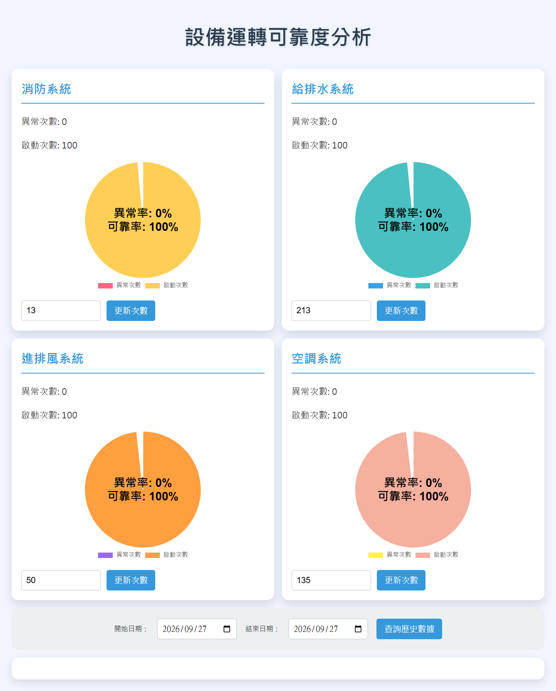

# 系統可靠度與警報統計

## 分系統檢視畫面

原程式的分析介面按系統分區，顯示異常次數、啟動次數與比例，並提供日期查詢。截圖來自未接現場資料的介面展示，畫面中的預設次數不代表案場績效。

## 現場痛點

BA 警報點位分散在不同系統，單看即時畫面難以比較一段期間各系統的異常次數。不同點位的「異常值」也可能有不同定義，不能一律用同一個條件判斷。

## 我做的處理

程式從點位對照表建立系統映射，依系統條件判斷異常，查詢本月紀錄並彙總每個系統的次數；管理介面可設定門檻並查詢資料。這呈現我把 BA 點位語意和統計需求寫進程式的能力。

## 從警報紀錄到可比較的資訊

計算前先回答兩個問題：這個點位屬於哪個系統？什麼值才算該系統的異常？程式建立映射及判斷條件後，才按月份彙總。若略過前兩步，只把所有 0／1 值相加，報表可能把正常狀態算成故障。
